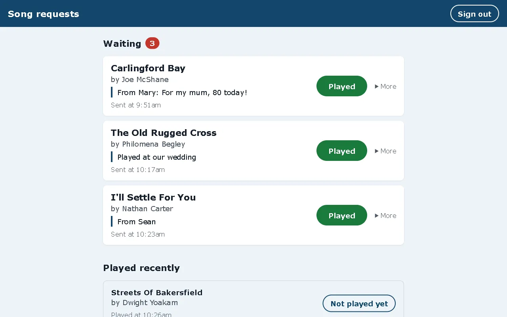

# Coast Requests

[Portfolio case study](https://jamieparr.dev/projects/coast-internet-radio/)

[](https://github.com/JamieP-205/coast-requests/actions/workflows/test.yml)

Song requests from the [Coast Internet Radio](https://coastinternetradio.com) website, in one list Jim can work through during his live shows.

Before this, requests only arrived by email, so Jim had to search his inbox mid-show. Now each request also appears on a board, oldest first, and he taps **Played** as he goes.



*The board, shown with sample requests.*

## How it works

1. A listener fills in the request form on coastinternetradio.com.
2. Netlify Forms emails it to the station, as before, and also sends it here as an outgoing webhook.
3. The app checks Netlify's signature, then stores the request in a SQLite database.
4. Jim signs in and sees what's waiting. The board checks for new requests every 20 seconds and reloads only when something has changed.

## Built with

Python, Flask, Flask-SQLAlchemy (SQLAlchemy 2), Jinja templates, PyJWT for checking Netlify's signature, and pytest. Hosted on PythonAnywhere.

```
coast_requests/
  __init__.py   creates the app, security headers
  config.py     settings from environment variables
  models.py     the song_requests table
  webhook.py    receives and checks requests from Netlify
  auth.py       Jim's sign-in and CSRF protection for every form
  board.py      the list, Played, Not played yet and Remove
  cli.py        hash-password and add-sample-requests commands
tests/          pytest tests for each part
docs/           deploying to PythonAnywhere
```

## Running it locally

```
python -m venv .venv
.venv\Scripts\activate          (or: source .venv/bin/activate)
pip install -r requirements-dev.txt
copy .env.example .env          (then fill it in)
flask --app coast_requests hash-password
flask --app coast_requests add-sample-requests
flask --app coast_requests run
```

Put the hash from `hash-password` into `ADMIN_PASSWORD_HASH` in `.env` before running the app. `add-sample-requests` only works with `FLASK_DEBUG=1`, so it can't add made-up requests on the live server.

Deploying to PythonAnywhere is in [docs/deploying.md](docs/deploying.md).

## Tests

```
pytest
```

They cover the webhook signature, duplicate and unwanted submissions, sign-in, CSRF protection, marking requests played, escaping listeners' text, and UK times.

## Security

- Netlify signs every webhook. A request without a valid signature over its exact body is refused.
- Jim's password is stored only as a hash, in an environment variable.
- Every form has a CSRF token, and the session cookie is HttpOnly, Secure and SameSite=Lax.
- Listeners' text is escaped by Jinja, and a Content-Security-Policy only allows the app's own files.

## What I'd improve next

- Pause sign-in after several wrong passwords.
- Let Jim mark a request as "can't play this one" with a reason, instead of only removing it.
- Move to MySQL or PostgreSQL if more than one presenter starts using it.

## How I use AI on this project

I built this in October 2026. Claude Code assisted with coding. The idea came from how Jim was handling requests during his shows. I set up the hosting on PythonAnywhere, connected the Coast website's request form to it with a Netlify webhook, tested it and look after it.
