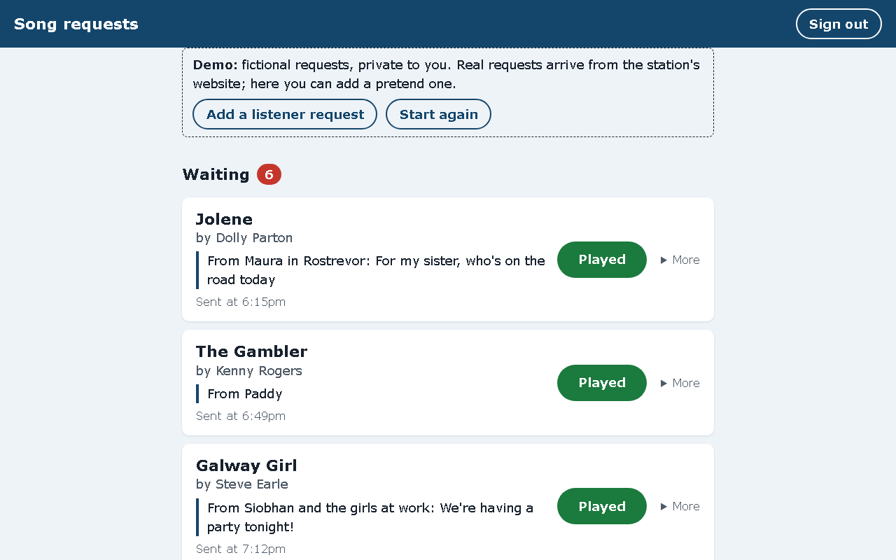
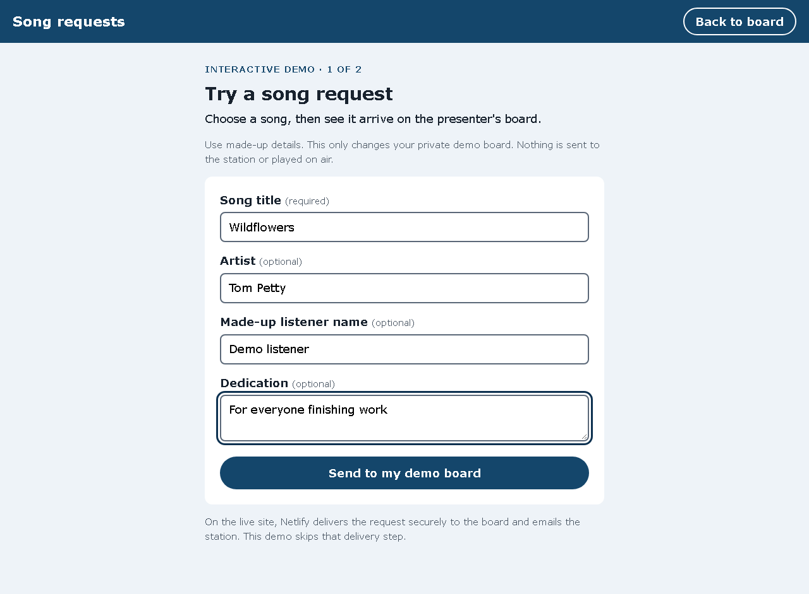

# Following one request through the demo

5 November 2026

## The problem

The public demo could add a randomly selected sample request. That showed the board working, but a visitor couldn't enter a song and follow that exact request from submission to Played.

## The change

**Try the listener form** opens a small form for a song, artist, made-up listener name and dedication. Submitting it opens the visitor's board at the new request, outlined in navy. The list stays oldest first. Played moves it into Played recently; Not played yet returns it to the queue.

The random sample button is still available as **Add a sample request**.

| Before | After |
| --- | --- |
| The visitor could only add a random sample. | The visitor can choose a song and follow it through the board. |
| A new sample was added at the bottom of the queue. | Submission opens the board at the exact new request. |

## Verification

- All 37 pytest tests pass locally. Five new tests cover the submitted request through Played, visitor isolation, required titles, escaping and field limits, the board cap, and access restrictions. The existing CSRF test also checks the new form.
- Browser checks at 1280, 390 and 320 pixels: submit, find the request, mark Played, return with Not played yet, and submit a long title without horizontal overflow.
- No automated axe accessibility violations on the form or board at those widths. This is not a full accessibility audit.
- The recording uses the running local demo, real browser interactions and fictional requests. It is silent and captioned. It is not a recording of a live radio broadcast or a real listener's request.

## Limits and ownership

The live route is listener form → Netlify → signed webhook → database → presenter board. The demo writes to its private database directly, so it demonstrates the form and board, not live webhook delivery. It sends no email, plays no music and changes nothing at the station.

The update was implemented and checked with Codex at Jamie's request. No presenter feedback, time-saving measurement or user-test result has been collected for this change.

## Talking through the code

- `coast_requests/demo.py`: `listener_request` validates the form and saves it to the visitor's database.
- `coast_requests/templates/demo_request.html`: labelled fields, limits and error messages.
- `coast_requests/templates/board.html`: the form link and an anchor for each waiting request.
- `coast_requests/board.py`: the existing Played and Not played yet actions; unchanged by this update.
- `tests/test_demo.py`: checks the new flow and its boundaries.

Useful interview questions to practise: Why keep oldest-first ordering? Why validate on the server if the field is required in HTML? How does each demo visitor get a separate database? What does this demo leave out of the live system?
